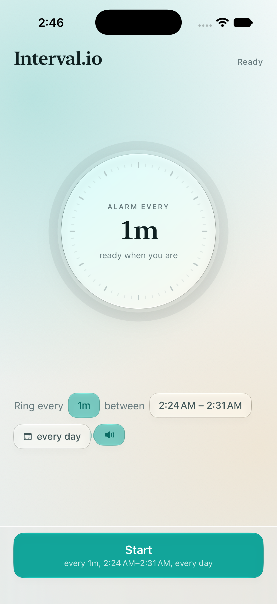
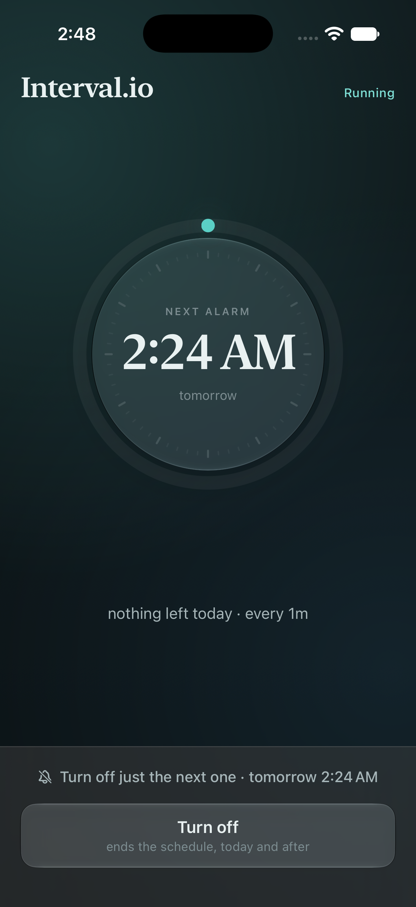

# timerX

**Interval.io** — an iPhone alarm that rings on a rhythm you choose, and lets you
turn off the whole thing or just one alarm.

Set it up by editing one sentence:

> Ring every **2h** between **8:00 AM – 10:00 PM**, **every day**

Change the start to **now** and the window disappears — a timer and a daily
schedule are the same thing with a different beginning.

| Light | Dark |
| --- | --- |
|  |  |

## What it does

- **Rings every X** — hours, minutes or seconds, from a preset or a custom gap.
- **Two shapes of schedule.** *From now*, which runs until you stop it or for a set
  number of repeats. Or a *daily window* — first alarm, stop-by time, and which days
  — that repeats every day on its own.
- **Turn off one, or all.** The whole schedule ends with one button. A single alarm
  can be turned off without touching the rest; on a daily schedule that skips
  today's and leaves tomorrow's alone.
- **Act from the lock screen.** The alarm notification carries three buttons:
  *Turn Off This One*, *Skip the Next One*, and *Turn Off All*.
- **Undo instead of confirm.** Turning off happens immediately and offers Undo for
  six seconds, restoring the schedule on its original clock.
- **Alarms never cross midnight.** A window ends at its stop time and starts again
  the next day.
- Light and dark throughout, a custom alarm tone, and haptics on each ring.

## Requirements

- Xcode 16 or later
- iOS 17.0+ (Liquid Glass is used on iOS 26+, with a fallback below that)

## Build and run

```bash
open IntervalAlarm.xcodeproj
```

Or from the command line:

```bash
xcodebuild -project IntervalAlarm.xcodeproj -scheme IntervalAlarm -sdk iphonesimulator -destination 'platform=iOS Simulator,name=iPhone 17' -derivedDataPath build CODE_SIGNING_ALLOWED=NO build
```

```bash
xcrun simctl install booted build/Build/Products/Debug-iphonesimulator/IntervalAlarm.app && xcrun simctl launch booted io.interval.app
```

To run it on a device, open the project, pick your team under **Signing &
Capabilities**, and change the bundle identifier to something you own.

## How it works

| File | Role |
| --- | --- |
| `Schedule.swift` | The model. One type covers both shapes: an interval plus either `fromNow(startedAt:totalRepeats:)` or `daily(start:end:days:)`. Fire times are derived rather than stored, so a schedule rebuilds exactly after a force-quit or a reboot. |
| `AlarmEngine.swift` | Hands the schedule to iOS and takes it back. Holds the live clock, the undo buffer, and the notification actions. |
| `ContentView.swift` | The one screen: dial, the sentence, and the buttons. |
| `AlarmDial.swift` | The dial, and the moment it plays when an alarm lands. |
| `DesignTokens.swift` · `Components.swift` · `Glass.swift` | The design system: tokens, the button hierarchy, and the glass layer. |

### Two scheduling strategies

**Counting from now** queues a chain of elapsed-time notifications and tops them up
whenever one fires or the app comes forward.

**A daily window** uses repeating *calendar* notifications — one per alarm, plus one
per weekday when you pick days. That anchors it to the clock on the wall, so 6:00
stays 6:00 through daylight saving, and the schedule keeps running forever without
the app being opened.

Scheduling reconciles against what iOS already holds rather than wiping and
rebuilding, so the queue is never momentarily empty.

### The notification budget

iOS holds 64 pending notifications per app, which decides how much of a daily
schedule can run unattended:

| Days selected | Alarms a day that run forever untouched |
| --- | --- |
| Every day | ~60 |
| Weekends | ~30 |
| Weekdays | ~12 |

Every-day schedules are effectively free. When a schedule is denser than that, the
app falls back to a rolling queue of the next 60 alarms and says so on screen rather
than quietly dying a few days later.

## Worth knowing

- **These are notifications, not Clock alarms.** They are sent as *time-sensitive*
  so they break through Focus, but unlike Apple's Clock app they respect the ringer.
  Nothing but Clock can override the mute switch.
- **Permission is required.** The first Start asks; if it is denied the app shows a
  banner with a shortcut to Settings, and nothing can ring until it is granted.
- **Sub-minute gaps are best-effort.** iOS does not guarantee a 2-second alarm.
  Roughly 30 seconds and up behaves reliably.

## Design

The interface follows a single design language, and the reasoning — personality,
palette, the one-sentence setup, why glass is used the way it is — is written up in
[DESIGN.md](DESIGN.md).

## Licence

No licence has been chosen yet, so default copyright applies: all rights reserved.
Add a `LICENSE` file if you want others to be able to use it.
